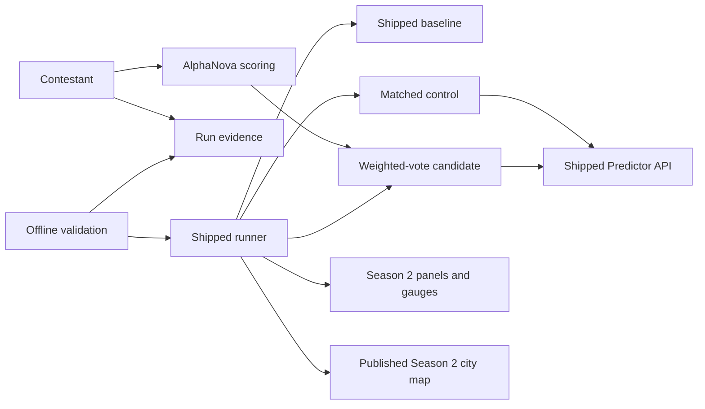

# Architecture Spine — Cycle 1 Predictor and Validation

## Design Paradigm

A **pipes and filters** design inside one submission class. Training fits state for a split. Prediction applies the rank, feature, estimator, and position stages in order. A separate offline command owns verification.

## Invariants & Rules

### AD-1 — Submission boundary [ADOPTED]

- **Binds** CAP-1, CAP-4
- **Prevents** Research dependencies or local evaluation data entering the submission.
- **Rule** Deliver one self-contained UTF-8 `.py` file without a BOM. Keep logic inside the subclass and preserve the shipped signatures. Declare extra dependencies with PEP 723. The offline command may load artifacts through the runner. The predictor may use the shipped interface and contest-supported dependencies, and it receives data through `train` and `predict`. Keep the kit source unmodified. City maps, run records, and the offline command stay outside the submission.

### AD-2 — Matched comparison [ADOPTED]

- **Binds** CAP-1, CAP-2
- **Prevents** Candidate and control drifting beyond the weighted vote.
- **Rule** Materialize two self-contained files from one maintained source revision. The vote is selected by one in-class value fixed in each file. Verify the files differ only at that selector. Use the same base ranks, learner settings, seed, and position shaping. Bind every candidate check and the submission handoff to the same artifact digest.

### AD-3 — Fit state and causal inference [ADOPTED]

- **Binds** CAP-1
- **Prevents** Label leakage, cross-period state, or forecasts that change with call order or row position.
- **Rule** Each fit owns its learned feature orientations and model state. Learn orientations keyed by feature label from the current training split only. Leave the runner’s optional full-panel `generate_features` hook unused. Inference reads the fitted state and the supplied observations at or before the scored hour. Use finite trailing history anchored to the input time index, keep prediction state read-only, and support repeat calls, equivalent padding, and reload. Train and predict tolerate permuted gate rows and variable lengths. Inference accepts frames that overlap training. Fit state carries no ticker identities across periods.

### AD-4 — Labeled feature and position contract [ADOPTED]

- **Binds** CAP-1, CAP-2
- **Prevents** Misaligned rank, label, and position matrices.
- **Rule** Rank each of the six supplied features over the 20 assets at the same hour. Align training labels and features by timestamp and asset name. The candidate takes the arithmetic mean of signed votes already weighted by rank distance from the median, using orientations from the fitted state. Return one finite vector per input row with the same timestamp index, row order, and ordered asset columns. Each vector sums to zero.

### AD-5 — One local decision authority [ADOPTED]

- **Binds** CAP-2, CAP-3
- **Prevents** Comparing different validation samples or passing a rounded or partial novelty result.
- **Rule** One offline command owns the evidence checks and local decision. Require a successful quick run with a de-mean pass. Compare the baseline, candidate, and control via the shipped full walk-forward with the same kit, data snapshot, runtime, scoring settings, and complete expected per-period observation counts. Require passing model-behavior checks, per-call elapsed time on CPU within the contest limits, and measured peak memory below the contest limit. Use the runner’s returned metrics at full precision. Local readiness requires finite positive net Sharpe strictly above the shipped baseline and a finite nearest-city distance of at least 60° from a comparison covering all expected candidate gauge rows against the official map current at decision time. Hold for failed checks or incomplete evidence. Report the matched-control delta as experiment evidence.

### AD-6 — Run and verdict provenance

- **Binds** CAP-2, CAP-3, CAP-4
- **Prevents** Evidence being associated with a different artifact, environment, or scoring authority.
- **Rule** Keep each completed or failed attempt as a separate record. Key it to the exact artifact digests, kit and input snapshots, map snapshot when used, resolved runtime, settings, and observed coverage. Write separate quick, full, and novelty results. Link the official entry verdict, settled Sharpe, and quality-set membership to the submitted artifact digest and Cycle 1. The contestant owns submission. AlphaNova owns the official verdict.

## Execution Environments

- Run local validation in one isolated CPU environment with the kit as the runner working directory. Use the kit’s Python 3.12 recommendation as the compatibility reference. Resolve kit and variant dependencies before scoring, including XGBoost for the shipped baseline. Capture exact versions and set `COMP6_DISABLE_PIP_INSTALL=1` for the attempt. Keep the evidence and generated artifacts separate from the shipped Python files.
- Stage the official map for the runner’s `signal_db` lookup. Record source, acquisition time, and digest. Keep the staged snapshot fixed for the attempt and serialize attempts that share the kit working directory. If a new map supersedes it before the decision, refresh the novelty evidence for the same candidate.
- Submit the exact locally evaluated candidate file to AlphaNova under the organizer’s CPU, elapsed-time, and memory limits. Keep the local run environment independent of the contest’s execution environment.

[Kit setup](../../../../requirements/README.md#setup) · [Python release status](https://www.python.org/getit/) · [XGBoost installation guide](https://xgboost.readthedocs.io/en/stable/install.html)

## Capability → Architecture Map

| Capability | Lives in | Governed by |
| --- | --- | --- |
| CAP-1 | Submission class and fitted pipeline | AD-1 through AD-4 |
| CAP-2 | Offline runner invocation and comparison record | AD-2, AD-4, AD-5, AD-6 |
| CAP-3 | Offline gauge-fix and local decision | AD-5, AD-6 |
| CAP-4 | Contestant handoff and official verdict record | AD-1, AD-6 |

## Deferred

- Orientation estimator, rank tie and missing-value handling, learner parameters, and smoothing settings. Choose within the shared pipeline at implementation.
- Evidence file format and variant filenames. The offline command owns these details under AD-2 and AD-6.
- Rank-change and turnover-only experiments, later-cycle signals, and hosted orchestration. Revisit when those scopes are planned.
